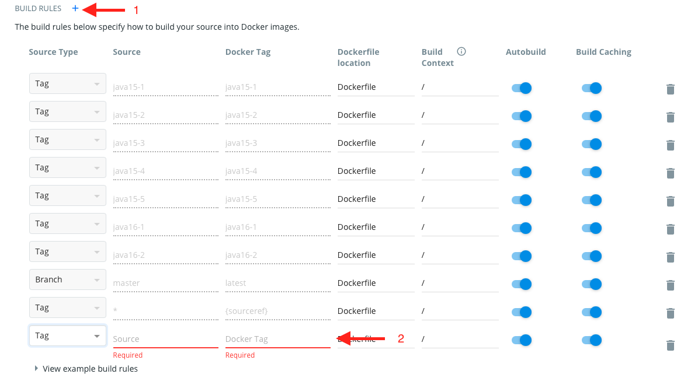

import Callout from "../../src/components/Callout/Callout";
import {CalloutVariant} from "../../src/components/Callout/Callout.types";

## GitHub Actions dependencies

Every external action in workflows and composite actions is pinned to a full commit SHA,
including actions maintained by GitHub. A trailing `# vX.Y.Z` comment records the release
version. Resolve the upstream release tag to its commit when adding an action; a major-version
tag alone is mutable and does not provide the same guarantee. The workflow lint job runs
`python3 supporting_scripts/check_action_pinning.py`, which fails the build for any reference that
is not pinned this way, so you can run it locally before pushing a workflow change (it needs
PyYAML, `pip install pyyaml`). The checker accepts three kinds of reference: an action or a
remote reusable workflow pinned to a commit SHA with its version comment, a local path such as
`./.github/actions/e2e-setup` or `./.github/workflows/ci-build.yml`, and a Docker image pinned by
its `sha256` digest (`docker://image@sha256:...`). It parses the files as YAML and checks the
`uses` of jobs and steps, so it finds an entry however it is written, ignores text in comments and
`run:` scripts as well as ordinary keys such as `env.uses`, and reports a file that is not valid
YAML instead of skipping it. The version comment has to follow the reference itself.

Renovate uses `helpers:pinGitHubActionDigests` to propose hash updates and pin new references.
Review those pull requests so actions continue receiving security fixes. Local actions and
reusable workflows use relative paths. The
[workflow reference](https://github.com/ls1intum/Artemis/blob/develop/.github/workflows/README.md#action-pinning-policy)
describes the policy, and the [Scorecard report](https://scorecard.dev/viewer/?uri=github.com/ls1intum/Artemis)
shows dependency-pinning findings alongside other repository security checks.

## Installer, container and Python dependencies

The Ubuntu LocalCI installer downloads k3s and Helm installer scripts from immutable upstream commits,
checks their committed SHA-256 hashes before invoking `sudo`, and selects explicit release versions.
When updating an installer, update the version, commit URL and checksum together in
`deployment/kubernetes/install-localci-kubernetes-ubuntu.sh`. Download the script from the reviewed upstream release commit
and compute its hash locally; the installer must never download its expected hash alongside the script.
The upstream installers also verify their release binary checksums.

Docker base images use a tag and a digest. Use the multi-platform manifest digest so the helper image
still builds on both amd64 and arm64. Renovate's `docker:pinDigests` preset keeps these references pinned
when proposing updates.

Python tools keep their direct requirements in `requirements.in` and a generated, complete lock with
SHA-256 hashes in `requirements.txt`. Install into a virtual environment using:

```bash
python -m pip install --require-hashes -r requirements.txt
```

Edit the input file, then regenerate the locks with uv 0.12.23 or newer from the repository root:

```bash
supporting_scripts/update_python_dependency_locks.sh
# To update transitive dependencies as well:
supporting_scripts/update_python_dependency_locks.sh --upgrade
```

Renovate's `pip-compile` manager reads the generated uv command and updates inputs and hashes together;
standalone `pip_requirements` updates are disabled to avoid editing a lock without regenerating hashes.
Review and commit the inputs and generated locks together. Universal resolution retains Python and
platform markers instead of locking only the maintainer's machine. Tool locks resolve for Python 3.10
and newer; individual tools can require a newer version, as described in their READMEs. The deployment
lock in `.github/python-dependencies` targets the workflow's Python 3.14 environment. It records the
Artemis-Ansible requirements snapshot it was based on; update it when changing that environment.
Source distributions such as Whisper still use pip's build isolation, whose build dependencies are
outside pip's requirements hash checking.

## General Structure of Programming Exercise Execution

Artemis uses docker containers to run programming exercises. This ensures that the students' code does not have
direct access to the build agents' hardware.
To reduce the time required for each test run, these docker containers already include commonly used dependencies
such as JUnit.

There are currently docker containers for:

- [Maven (Java)](https://github.com/ls1intum/artemis-maven-docker)
- [Kotlin](https://github.com/ls1intum/artemis-kotlin-docker), published to `ghcr.io` when a release `vX.Y.Z` is created in its repository
- [OCaml](https://github.com/ls1intum/artemis-ocaml-docker)
- [Python](https://github.com/ls1intum/artemis-python-docker)
- [C](https://github.com/ls1intum/artemis-c-docker)
- [Swift](https://github.com/ls1intum/artemis-swift-swiftlint-docker)
- [Ruby](https://github.com/ls1intum/artemis-ruby-docker)
- [Dart](https://github.com/ls1intum/artemis-dart-docker)
- [C#](https://github.com/ls1intum/artemis-csharp-docker)
- [Haskell](https://github.com/uni-passau-artemis/artemis-haskell) (external)
- [Assembler](https://hub.docker.com/r/tizianleonhardt/era-artemis-assembler) (external)
- [VHDL](https://hub.docker.com/r/tizianleonhardt/era-artemis-vhdl) (external)

## Steps for Updating the Docker Builds used in Artemis

For images published on Docker Hub, updating requires access to that account. If you need access,
contact Stephan Krusche. Kotlin uses GitHub Container Registry instead; follow its tag-based release path
in [Keeping the images in sync](#keeping-the-images-in-sync-with-the-templates) rather than the Docker Hub steps below.

1. Update the dependencies via a pull request in the repository of the docker container.
   Each docker container has its own repository as listed above.
2. After the PR got merged, go to the build overview on Docker Hub:
   - Choose the correct repository on [Docker Hub](https://hub.docker.com/orgs/ls1tum/repositories)
   - Go to the "Builds" tab of that repository
3. Wait for a successful build of "latest"
4. Click "Configure Automated Builds" and create a new build rule for a new tag, following the naming scheme:
   `<programming language><Version of programming language>-<Upwards counting number>`, for example `java25-1`
   - The "Sourcetype" should be "Tag"
   - This tag should be used as "Source Tag" and "Docker Tag"

   

5. Go back to the repository of the docker container in GitHub and create a new Tag
   - Click "Releases" on the right on the front page of that repository
   - Create a new release with the button called "Draft release" and give it the same name as in step 4
6. Wait for the build in Docker Hub of the newly created Tag
7. Change the docker image used in Artemis to the newly created tag:
   [application.yml](https://github.com/ls1intum/Artemis/blob/develop/src/main/resources/config/application.yml).
   Do this in the same pull request that changes the templates, see the next section.
8. If the used docker container should also be changed for already created exercises you have to change
   the build plan of that exercise
   - Change the docker image used by following this path: Configure Buildplan > Default Job > Docker > Docker Image

## Keeping the images in sync with the templates

The images of Java, Kotlin, Rust, JavaScript, TypeScript, Swift, Ruby, Dart, C#, Go and Haskell hold the dependencies or the toolchain of a copy of the test template in their repository.
It has to pin the same versions as the test templates in `src/main/resources/templates`:

| Language | Cached project in the image repository | What has to match the templates |
| --- | --- | --- |
| Java | `artemis-java-template` | Ares, AspectJ, Guava, the Maven plugins, the Gradle plugins and wrapper, the static code analysis tools |
| Kotlin | `artemis-kotlin-template` | Ares, AspectJ, Kotlin, Guava, the Maven plugins |
| Rust | `test` | the crates in `Cargo.lock` of the test project and of the assignment |
| JavaScript, TypeScript | `vitest/javascript`, `vitest/typescript` (each with `staticCodeAnalysis`) | the packages in `package-lock.json`, including the ones of the assignment, which the test project builds as an npm workspace |
| Swift | `test` | the packages and version requirements in `Package.swift` |
| Ruby | repository root (`Gemfile`, `Gemfile.lock`) | the gems in every `Gemfile.lock` of the templates (regular and static code analysis, test, exercise and solution), which the lock file of the image has to contain |
| Dart | repository root (`pubspec.yaml`, `pubspec.lock`) | the packages in `pubspec.lock` of the test project and of the assignment |
| C# | repository root (`test.csproj`) | the NuGet packages and the target framework in `test.csproj` and in the project files of the assignment |
| Go | `Dockerfile` (base image `golang`) | the `go` directive of every `go.mod` must not be newer than the Go version of the image (a `toolchain` line is ignored, the image sets `GOTOOLCHAIN=local`) |
| Haskell | `Dockerfile` and `stack-config/global-project/stack.yaml` | the `resolver` of every `stack.yaml` is the Stackage snapshot of the image, and the test project only depends on packages the Dockerfile builds ahead (`base` and the local libraries excepted) |

A version that the image does not hold is downloaded by every build of every exercise (from Maven Central, crates.io, the npm registry, RubyGems, pub.dev, NuGet or GitHub),
which costs build time and runs into rate limits.

Two checks keep both sides together without downloading any dependency in the pull request pipeline:

- **Pull requests** run `python3 supporting_scripts/check_exercise_image_sync.py` (job `Exercise Images`) when the templates,
  the build phases, the image configuration in `application.yml` or the check itself change. It reads the template project of the image
  at the git tag of the configured image from its repository and fails for every version the templates pin that the image does not hold.
  It needs no Docker and finishes in seconds.
- **Every night** the workflow `Nightly Exercise Images` runs `python3 supporting_scripts/verify_exercise_images_offline.py`. It assembles
  the test and assignment repositories like the server does, pulls the configured image and runs the build phases of
  `src/main/resources/templates/phases` in a container without network access. A dependency that the image does not hold turns into a failed
  build and a tracking issue, and so does a test phase that leaves no JUnit report with a test case or a report with a failed test case (several test phases hide the exit status of the tests, and the templates are built from their solution, so every test has to pass). This catches what a version comparison cannot, for example a transitive dependency or a changed build phase.
  You can run it locally for one language, e.g. `--language kotlin`. Add `--platform linux/amd64` for an image that is not published for your CPU
  (the Kotlin, Rust, Ruby, Dart and C# images are only published for amd64, and the npm packages of the JavaScript and TypeScript image depend on the CPU).
  The `c-gcc` variant fails on a bind mount of a case-insensitive file system such as the default one of macOS: its `setup_makefile` phase ends with `cp: cannot create regular file 'assignment/Makefile': File exists`, and the `Makefile` of the assignment is gone afterwards. It passes on Linux, which is where the nightly workflow runs, and when the repository is copied into the container.

To change a version that is part of an image:

1. Change what the image holds in its repository and merge it: the cached project for most languages, the `FROM golang:X.Y.Z` line of the `Dockerfile` for Go
   (pin a patch release, a rolling tag such as `golang:1.24` names no version), the `resolver` of `stack-config/global-project/stack.yaml` and the `--package` list of the
   `Dockerfile` for Haskell. Build the image locally and run the verification with
   `--image <language>=<local image>` (for example `--image rust=my-image:test`) before you release.
2. Release the image with a new tag:
   - **Java:** follow the Docker Hub procedure above, using the same Git tag and Docker image tag.
   - **Kotlin, Rust, JavaScript, TypeScript, Ruby, Dart and C#:** push a new `vX.Y.Z` Git tag to the repository of the image ([artemis-kotlin-docker](https://github.com/ls1intum/artemis-kotlin-docker), [artemis-rust-docker](https://github.com/ls1intum/artemis-rust-docker), [artemis-javascript-docker](https://github.com/ls1intum/artemis-javascript-docker); TypeScript uses the JavaScript image; [artemis-ruby-docker](https://github.com/ls1intum/artemis-ruby-docker), [artemis-dart-docker](https://github.com/ls1intum/artemis-dart-docker), [artemis-csharp-docker](https://github.com/ls1intum/artemis-csharp-docker)) and publish a GitHub release for that tag. The tag-push workflow publishes `ghcr.io/ls1intum/<repository>:vX.Y.Z`; wait for it to finish. No Docker Hub build rule is needed.
   - **Swift:** push a new `vX.Y.Z` Git tag to [artemis-swift-swiftlint-docker](https://github.com/ls1intum/artemis-swift-swiftlint-docker) and publish a GitHub release for that tag. The workflow publishes the tag to `ghcr.io/ls1intum/artemis-swift-swiftlint-docker` and to Docker Hub.
   - **Go:** push a new `vX.Y.Z` Git tag to [artemis-go-docker](https://github.com/ls1intum/artemis-go-docker) and publish a GitHub release for that tag, like for the images above. The tag-push workflow publishes `ghcr.io/ls1intum/artemis-go-docker:vX.Y.Z`. The Go version of the image is the one of its `Dockerfile`, so a new Go release is a new tag, and the `go` directive of the three `go.mod` templates may then be raised to it.
   - **Haskell:** the image is maintained outside of Artemis, in [uni-passau-artemis/artemis-haskell](https://github.com/uni-passau-artemis/artemis-haskell) (open an issue or a pull request there; you need the maintainers of that repository for a release). A new Stack resolver is published as a tag `vMAJOR.MINOR.0` of the Stackage snapshot (`v22.37.0` for `lts-22.37`), which the tag-push workflow publishes to `ghcr.io/uni-passau-artemis/artemis-haskell`. In Artemis, change the `resolver` of the three `stack.yaml` templates in `src/main/resources/templates/haskell` and the image tag in `application.yml` together.

   In every case, keep the image tag identical to the Git tag: the version check reads the image's files at that Git tag.
3. Change the versions in the templates and the image tag in `application.yml` in one pull request in Artemis. The pull request check
   fails as long as the tag in `application.yml` does not hold what the templates pin.

The other languages cache no dependency that a template pins. The table in [Choose a Programming Language](/instructor/exercises/programming-exercise#supported-programming-languages) shows the status of every language. In short:

- **Nothing to compare**: Python, C, C++, VHDL, assembler, OCaml, R and Bash use the standard library or tools the image installs (pytest, `junit-xml`, Catch2, `bats`, `testthat` and so on). The pull request check has nothing to compare, but the nightly workflow builds all of them in their image without network access, so a template that starts to need something the image does not have fails there. MATLAB is the exception: it needs a license server and is not built.
- **Go** imports only the standard library and the student module through a local `replace`, so `go test` fetches no module. The image sets `GOTOOLCHAIN=local`, so a `go` directive newer than the Go version of the image makes every build of every Go exercise fail (the check compares them), and `.golangci.yml` has to match the major version of `golangci-lint` in the image.
- **Haskell** uses an external image ([uni-passau-artemis/artemis-haskell](https://github.com/uni-passau-artemis/artemis-haskell)). Its tag is the Stackage snapshot (`v22.37.0` for `lts-22.37`), which is the `resolver` of the templates. The sequential variant is not built nightly: both of its stages run `./run.sh -s`, which deletes the solution and the tests after the first stage, so the second stage cannot build, whatever the image holds.
- **Layout of the checkouts**: Ruby, Dart, C#, C, VHDL, assembler, OCaml, Go and Bash (and MATLAB) check the test repository out into `tests` next to the `assignment` directory, so the offline build does the same. Haskell and OCaml also check the solution repository out into `solution`. `RepositoryCheckoutService` decides this for every language, and a unit test compares the assembly with it. The static code analysis files of the solution (`staticCodeAnalysis/solution`, used by Ruby and Dart) are copied into the assignment.
- **Ruby, Dart and C#** cache the lock file of one project each (`bundler install`, `dart pub get`, `dotnet restore`) and the tools the phases call (`junitreport` and `analyze_sarif` in the Dart image, the analyzers of the .NET SDK for C#). Those tools are not pinned in the templates, so only the offline build notices a change there. The Ruby image has a single `Gemfile.lock`, which has to be a superset of the lock files of all templates; the static code analysis test project is that superset.
- **Swift** pins no `Package.resolved`, so its check compares the declared packages and version requirements. The image resolves them once, and SwiftPM finds any version a requirement allows in the cached clones. The Xcode project type has no build phases for the build agents (`templates/phases/swift` only covers the plain project type), so there is nothing to check for it.
