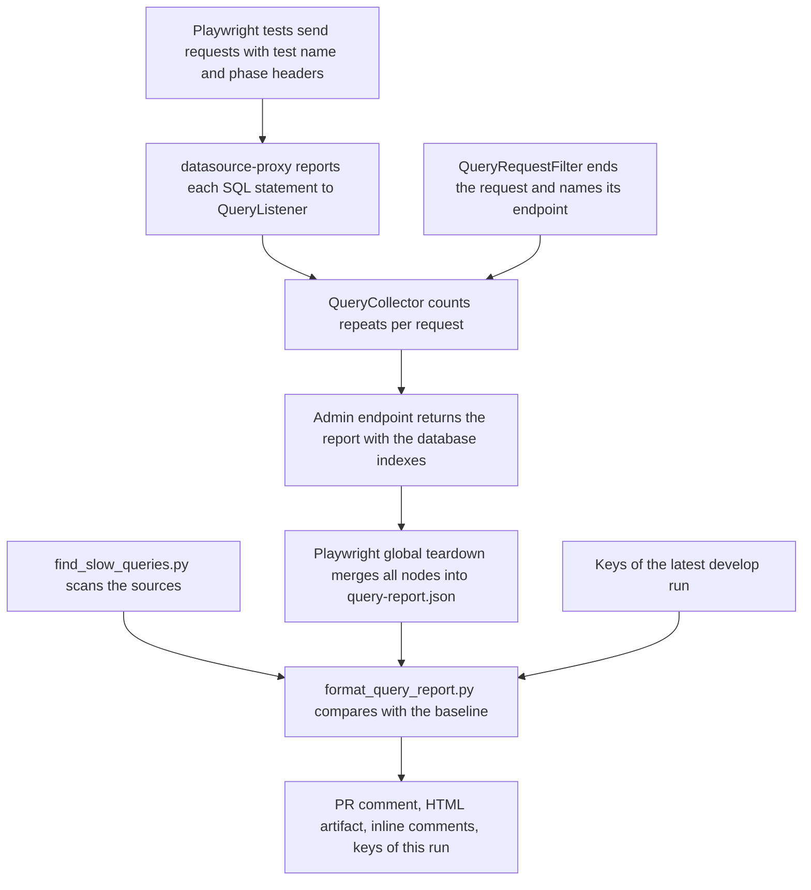

# How the query report works

## From a test run to the pull request

The teardown fetches the report because CI stops the server as soon as the Playwright container
exits; a later step would find no server.

## What counts as a finding

`QueryCollector` looks at one request at a time. A template is the normalized SQL; a call site is the
repository method and calling method.

| Shape                     | Condition within one request                                      |
| ------------------------- | ----------------------------------------------------------------- |
| N+1                       | One call site ran a template at least twice with different values |
| Duplicate, one place      | One call site ran a template at least twice with the same values  |
| Duplicate, several places | Several call sites ran the same statement with the same values    |

- Values are compared through `QueryListener.parameterSignature`, a SHA-256 digest cut to 64 bits.
  A sum of hash codes gave neighbouring ids the same result.
- A JDBC batch counts as one execution, because batching is the fix.
- Queries outside an HTTP request are ignored.
- The collector keeps one finding per key, test and phase: the one that could save the most queries.
  `artemis.performance.max-recorded-queries` limits how many; its only default is in
  `QueryProperties`. At the limit the report is marked as truncated.

The formatter groups findings into problems by where the fix goes: the method that loops, the endpoint
for data loaded by several places, or the table for rows inserted one statement at a time. It ranks
them by the queries one fix would save in a single request.

## Server files

All in `src/main/java/de/tum/cit/aet/artemis/core/config/performance` unless noted.

| File                                                                           | Responsibility                                                        |
| ------------------------------------------------------------------------------ | --------------------------------------------------------------------- |
| `QueryDataSourceConfiguration`                                                 | Wraps the `dataSource` bean with datasource-proxy                     |
| `QueryListener`                                                                | Normalizes SQL, digests parameters                                    |
| `QueryCallSite`                                                                | Walks the stack to the repository method, caller, file and line       |
| `QueryRequestFilter`                                                           | Ends a request: endpoint, test name, phase, state reset               |
| `QueryCollector`                                                               | Derives and stores findings                                           |
| `IndexCatalog`, `TableIndex`                                                   | Reads the database indexes once, skipping partial and expression ones |
| `RepeatedQueryFinding`, `QueryReportDTO`                                       | The report's JSON shape                                               |
| `QueryProperties`                                                              | Settings under `artemis.performance`                                  |
| `src/main/java/de/tum/cit/aet/artemis/admin/web/AdminQueryReportResource.java` | `GET api/admin/performance/query-report`, admins only                 |

## Analysis and CI files

| File                                                    | Responsibility                                                          |
| ------------------------------------------------------- | ----------------------------------------------------------------------- |
| `supporting_scripts/find_slow_queries.py`               | Static rules; also the counted gate of the Query Quality Check          |
| `supporting_scripts/format_query_report.py`             | Grouping, keys, comparison, comment, HTML page, inline comment contents |
| `supporting_scripts/analyze_query_report.sh`            | Runs the scan and the formatter in CI, removes stale outputs first      |
| `.github/actions/query-report/action.yml`               | Downloads the baseline, runs the script, uploads the artifacts          |
| `.github/actions/post-inline-query-comments/action.yml` | Calls the script below                                                  |
| `.github/scripts/post-inline-query-comments.js`         | Posts, updates and removes inline review comments                       |
| `.github/workflows/ci-e2e.yml`                          | Uses both actions in the E2E jobs                                       |
| `src/test/playwright/support/baseFixtures.ts`           | Sends the test name and phase headers                                   |
| `src/test/playwright/init/global-teardown.ts`           | Fetches the report from every node                                      |
| `src/test/playwright/init/mergeQueryReports.ts`         | Combines the node reports                                               |

## Baseline

Only a run of `develop` publishes its keys, as the artifact "Query Baseline", kept for 90 days. Pull
request jobs download the newest one. Without it nothing is marked as new and no inline comments are
posted. A pull request run does not publish keys.

## Phases and headers

`setup` marks the test's own API calls, `action` marks `/api` requests of the browser page. The setup
headers are set through `contextOptions`, because test setup uses `page.request`, which never passes
`page.route`. Header names are lower case, or an override is appended to the existing value.

## Ties to Artemis

These would need to become settings if the tool were moved elsewhere: the application package and the
skipped `AbstractApi` in `QueryCallSite`, the profile constant in `ArtemisConstants`, the Git route in
`QueryRequestFilter`, the security and feature usage annotations of the endpoint, and the guideline
link in the formatter.
